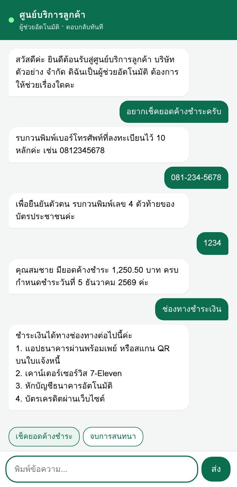

# Thai call-center bot (ผู้ช่วยศูนย์บริการลูกค้า)

A rule-based Thai customer-service assistant, built in the spirit of
[huggingface/pybot](https://github.com/huggingface/pybot): plain Python, no model, no training,
no packages to install. Every answer comes from rules you can read, test and audit.

- **Phase 1 (this): web chat, by typing or by voice.** A chat page and a JSON API.
  Hold 🎤 to talk (release to send), or tap it for hands-free. The bot answers aloud.
- **Phase 2: phone line.** The same bot core behind telephony, speech-to-text and text-to-speech.
  See [channels/voice/README.md](channels/voice/README.md).



## Run it

Needs Python 3.8 or newer, nothing else.

```bash
python -m channels.webchat.server
```

Open http://localhost:8000. Demo data: phone `0812345678` with ID last 4 digits `1234`
(or `0898765432` / `5678`), and order numbers `123456`, `654321`, `111222`.

```bash
python -m unittest discover -s tests
```

## Public demo on GitHub Pages

GitHub Pages serves static files only, so there the same chat page runs the Python bot
**inside the visitor's browser** with [Pyodide](https://pyodide.org) (Python compiled to
WebAssembly). The first load takes a few seconds. The page shows "โหมดสาธิต" (demo mode).

1. Push this folder to a **public** GitHub repository, on the `main` branch.
2. In the repository: **Settings → Pages → Build and deployment → Source: GitHub Actions**.
3. Each push to `main` runs `.github/workflows/pages.yml`: tests, then
   `tools/build_pages.py`, then deploy. The demo appears at
   `https://<your-user>.github.io/<repo-name>/`.

Browser mode is for demos only. Everything in it, including `backend.py`, is downloaded to the
visitor. Real customer data and API keys must stay on a server: run
`channels/webchat/server.py` in production. The same page then talks to it automatically.

## Talking by voice (in the browser)

The chat page uses the browser's own speech features (Web Speech API, `th-TH`). Nothing to
install, no API key, and it works on GitHub Pages.

- 🎤 **Speak**, two ways:
  - **Press and hold** (push-to-talk): talk while holding, release to send. Pauses while holding
    are fine. The bot answers aloud and waits for you.
  - **Tap** (hands-free): talk, and it sends when you pause. After the bot answers aloud it listens
    again, so a whole conversation runs hands-free. Tap 🎤 again, type, or press a button to stop.
  - Talking over the bot interrupts it.
- 🔊 **Spoken replies**: turned on automatically when you use the mic. Tap to switch off.
- Numbers said as words ("ศูนย์แปดหนึ่ง…", "หนึ่ง สอง สาม สี่") are understood as digits.

| Browser | Speak (🎤) | Spoken replies (🔊) |
|---|---|---|
| Chrome, Edge (desktop and Android) | Yes | Yes |
| Safari (Mac, iPhone, iPad) | Yes | Yes |
| Firefox | No: the mic button is hidden, typing works | Yes |

Notes:
- The microphone needs HTTPS or `localhost`. GitHub Pages is HTTPS.
- Spoken replies need a Thai voice on the device. Most phones have one. On Windows, add the Thai
  language pack if the bot is silent.
- **Privacy (PDPA):** in Chrome and Edge, speech is sent to Google's or Microsoft's servers to be
  recognised. Say so in your privacy notice. If voice must stay within your own systems, use a
  speech-to-text service you contract instead (see the phase 2 plan).

## AI answers (optional, Claude)

The rules answer the topics below. For anything else ("สมัครสมาชิกยังไง", "ย้ายที่อยู่ต้องทำยังไง"),
the bot can ask Claude, and the answer is shown **and read aloud** like any other reply.

```bash
pip install -r requirements-ai.txt
export ANTHROPIC_API_KEY=...      # from https://platform.claude.com
python -m channels.webchat.server --ai
```

- **Rules first.** Identity checks, balances, orders, tickets and handoff never go to the AI. It
  sees no customer records and has no tools, so it cannot look up or change anything.
- **Instructions:** the system prompt in `callcenter_bot/ai_fallback.py` tells the AI to answer in
  Thai with ค่ะ/คะ, in 1–3 sentences that sound natural spoken, using only the company facts in
  `config.py`, and to offer an agent when unsure. Add your FAQ facts there.
- **Privacy:** phone and ID numbers are masked before anything is sent (`privacy.py`). Recent turns
  are sent too, so follow-up questions make sense.
- **Labelled:** AI answers show "ตอบโดย AI · อาจคลาดเคลื่อนได้" in the chat.
- **Safe failure:** if the API is down, slow (20 s timeout) or declines, the customer gets the
  usual "ยังไม่เข้าใจ" reply with the agent option. The chat never breaks.
- **Model:** `claude-opus-5-5` at low effort. To lower cost for high volume, change `MODEL` in
  `ai_fallback.py`, e.g. to `claude-haiku-5-5`, and test the Thai quality on your own questions.
- **Not on GitHub Pages:** the API key must stay on a server. The Pages demo is rules-only.

## What it handles

| Topic | Example customer line | What happens |
|---|---|---|
| Greeting | สวัสดีครับ | Welcome and menu |
| Outstanding balance | บิลเดือนนี้ต้องจ่ายเท่าไหร่ | Asks for the phone number, verifies with the last 4 ID digits, gives the amount and due date |
| Payment channels | จ่ายได้ที่ไหนบ้าง | Lists the channels |
| Order status | ของยังไม่มาเลย | Asks for the order number and gives the status, carrier and expected date |
| Report a problem | เน็ตหลุดบ่อยตั้งแต่เมื่อวาน | Confirms the summary and opens a ticket |
| Opening hours | เปิดกี่โมง | Gives the opening hours |
| Human agent | ขอคุยกับเจ้าหน้าที่ | Hands off at any point (`handoff: true`) |
| Thanks / goodbye | ขอบคุณครับ, บายบาย | Polite close and session ends |

It also handles:
- **Thai input:** Thai digits, stretched letters (ครับบบ), polite particles, and numbers split
  with spaces or dashes.
- **Moving around:** "ยกเลิก" leaves the current step, and the customer can change topic mid-step.
- **Not understood:** after 2 misunderstood lines the bot offers a human agent. After 3 failed ID
  checks it hands off for account safety.

## Layout

| Path | What it holds |
|---|---|
| `callcenter_bot/config.py` | Brand name, bot voice (ค่ะ/ครับ), hours, payment channels, menu, limits |
| `callcenter_bot/intents.py` | Keyword lists per topic. **Tune recognition here.** |
| `callcenter_bot/normalize.py` | Cleans up Thai input before matching |
| `callcenter_bot/bot.py` | Conversation engine: topics, steps, verification, handoff |
| `callcenter_bot/ai_fallback.py` | Optional AI answers (Claude) for what the rules don't cover |
| `callcenter_bot/backend.py` | **Mock** customer, order and ticket data. Replace with your real APIs. |
| `channels/webchat/` | Web server (`server.py`) and chat page (`static/index.html`) |
| `channels/voice/` | Phase 2 plan |
| `tests/` | Unit and conversation tests |

## Adapting it to your company

1. **Your topics.** Add keywords in `intents.py`, then a `_on_<topic>` method in `bot.py`. Collect
   real chat logs and add the words customers actually use. This matters more than anything else.
2. **Your systems.** Rewrite the four functions in `backend.py` to call your CRM, billing, order
   and ticketing systems.
3. **Your wording.** Edit `config.py`, and the reply text in `bot.py`.
4. **Live agents.** In `channels/webchat/server.py`, at the `TODO` where `reply.handoff` is true,
   connect your agent desk (LINE OA, Zendesk, Freshchat, Genesys, ...).
5. **Optional AI fallback.** `Bot(fallback=fn)` calls `fn(message, session)` for lines no rule
   understood. Plug in an FAQ search or an LLM there, while the sensitive steps (identity checks,
   balances) stay rule-based.

## Before production

- Serve behind HTTPS (nginx, or a cloud load balancer). Add rate limiting.
- Sessions are kept in memory, so a restart forgets them and they work on one process only.
  Move them to Redis to run more than one server.
- PDPA: logs mask phone and ID numbers (`mask_digits`). Add a privacy notice to the chat page,
  and set a retention period for transcripts.
- Replace the identity check (last 4 ID digits) with whatever your security policy requires,
  such as an OTP by SMS.
