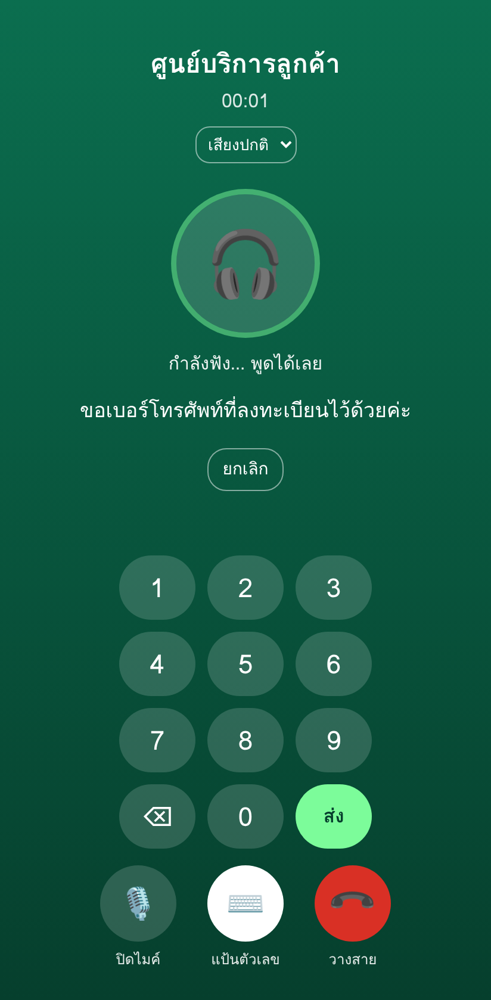

# Thai call-center bot for a bank (ผู้ช่วยศูนย์บริการลูกค้า)

A rule-based Thai customer-service assistant for a bank call center (POC), built
in the spirit of [huggingface/pybot](https://github.com/huggingface/pybot): plain Python, no model,
no training, no packages to install. Every answer comes from rules you can read, test and audit.

**What the bot does and doesn't do:** it answers *inquiries* (amounts due, loans, credit cards,
deposit balances, the status of the customer's own case) after checking identity: the caller's
number (Genesys ANI) plus the last 4 ID digits, or the 13-digit national ID number. *Requests*
that open work (close or refinance a loan, apply for a card, raise a limit, cancel a card,
transactions, complaints, lost cards) always go to an agent: the bot confirms what the customer
wants, verifies them, and transfers with what it learned (customer name, request, the loan, why
they close it, a summary and the transcript). It never opens cases itself, and this server never
calls ServiceNow: Genesys carries the data on.

- **Genesys Cloud voice bot (in use):** a Genesys voice Bot Flow does Thai speech-to-text and
  text-to-speech and sends each caller line to `POST /api/genesys/turn` with a Data Action; the
  reply is text. Setup: [channels/genesys/voice-bot-flow.md](channels/genesys/voice-bot-flow.md),
  Data Action to import: [channels/genesys/data-action.json](channels/genesys/data-action.json).
- **Phase 1: web chat, by typing or by voice.** A chat page and a JSON API.
  Hold the mic button to talk (release to send), tap it for hands-free, or press the phone button for a
  phone-call screen.
- **Genesys Cloud phone line (voice bot):** callers talk to the bot in Thai on a real phone line
  through Genesys Audio Connector, with Azure for Thai speech. See
  [channels/audio_connector/README.md](channels/audio_connector/README.md).
- **Genesys Cloud chat:** the same bot behind Genesys through Bot Connector. Genesys handles calls,
  speech and agents. See [channels/genesys/README.md](channels/genesys/README.md).
- **Phase 2: phone line.** The same bot core behind telephony, speech-to-text and text-to-speech.
  See [channels/voice/README.md](channels/voice/README.md).

 

## Run it

Needs Python 3.8 or newer, nothing else.

```bash
python -m channels.webchat.server
```

Open http://localhost:8000. Demo customers (national ID → who; calling from one of the phones
needs only the last 4 ID digits):

| National ID | Customer (phones) | Has |
|---|---|---|
| `3294367792962` | นางสาวพลอยใส ใจดี (0815493626, 0875679673) | home loan, Platinum card, savings, case CS0001001 |
| `1101700123456` | นายสมชาย ใจงาม (0812345678) | personal **and** home loan (the bot asks which), Signature card, savings + fixed deposit |
| `3100500678905` | นางวิภา รักษ์ดี (0861112233) | home loan, savings |
| `1509900543215` | นายทดสอบ ระบบ (0636538939) | Classic card (520.75 due), savings |

The **KTB PayOff PoC scenarios**, mirrored from ServiceNow's Core Banking mock (same names, phones
and loans, so ServiceNow's PayOff flow finds the caller; keep them in step with that mock):

| Scenario | National ID (last 4) | Customer | Phone (ANI) | Loan | Note |
|---|---|---|---|---|---|
| C1_URGENT | `1100800000011` (0011) | สมชาย ทดสอบ | 0810000001 | PHL-LN-0001, 2,450,000, 5.25% | must close within 5 days |
| C2_STANDARD | `1100800000029` (0029) | สมหญิง ทดสอบ | 0810000002 | PHL-LN-0002, 800,000, 5.5% | the usual case |
| C3_VIP | `1100800000037` (0037) | วิชัย ทดสอบ | 0810000003 | PHL-LN-0003, 1,200,000, 5.75% | VIP |
| C4_NOT_ACTIVE | `1100800000045` (0045) | มานี ทดสอบ | 0810000004 | PHL-LN-0004, closed | the bot says it is closed, offers an agent |
| C5_HIGH_LTV | `1100800000053` (0053) | ปิติ ทดสอบ | 0810000005 | PHL-LN-0005, 3,900,000, 5.1% | high LTV |
| C6_CB_DOWN | `1100800000061` (0061) | ชูใจ ทดสอบ | 0810000006 | PHL-LN-0006, 1,650,000, 5.35% | Core Banking down is a ServiceNow-side test |

Try the script: "ต้องการปิดบัญชีสินเชื่อบ้าน" → "ใช่" → "ขอทราบรายละเอียดก่อน" → "จะรีไฟแนนซ์ไปกสิกร"
→ "3.25 เปอร์เซ็นต์ เงินคืน 5000 บาท" → "ภายใน 30 วัน" → `3294367792962`.

```bash
python -m unittest discover -s tests
```

### Testing on your own machine

| URL | What |
|---|---|
| http://127.0.0.1:8000 | chat (no caller number here: verify with the 13-digit ID) |
| http://127.0.0.1:8100 | mock-data page (`python -m dataadmin`) |
| `POST http://127.0.0.1:8000/api/genesys/turn` | what the Genesys Data Action calls (header `x-bot-secret`) |

To test as Genesys does, with a caller number and the participant data on handoff (the secret
is `GENESYS_SECRET` in `voicebot.env`):

```bash
source voicebot.env
turn() { curl -s -X POST http://127.0.0.1:8000/api/genesys/turn \
  -H "Content-Type: application/json" -H "x-bot-secret: $GENESYS_SECRET" \
  -d "{\"sessionId\":\"local-1\",\"ani\":\"tel:+66810000002\",\"format\":\"text\",\"text\":\"$1\"}"; echo; }
turn ""                                  # call starts: greeting
turn "อยากปิดยอดสินเชื่อบ้านก่อนกำหนดครับ"
turn "ใช่"; turn "ปิดเลย"; turn "รีไฟแนนซ์ไปธนาคารบี"; turn "3.25 เปอร์เซ็นต์"; turn "ภายใน 30 วัน"
turn "0029"                              # last 4 ID digits: handoff with topic=payoff, loan_number=PHL-LN-0002
```

Change `sessionId` to start a new conversation.

### Reaching it from Genesys (tunnel)

Genesys must reach the server over HTTPS. On a test Mac, a Cloudflare quick tunnel:

```bash
cloudflared tunnel --no-autoupdate --url http://127.0.0.1:8000
```

It prints `https://<words>.trycloudflare.com`: put `https://<words>.trycloudflare.com/api/genesys/turn`
in the Data Action's Request URL Template. The URL changes every time the tunnel starts.

If the URL answers **530** and the log shows `dial ... :7844: i/o timeout`, the network blocks
port 7844 (UDP and TCP) that cloudflared needs (seen on office networks and VPNs). Use another
network (e.g. a phone hotspot), ask IT to allow outbound TCP 7844 to Cloudflare, or use a tunnel
over port 443 such as ngrok (needs an account).

## Public demo on GitHub Pages

GitHub Pages serves static files only, so there the same chat page runs the Python bot
**inside the visitor's browser** with [Pyodide](https://pyodide.org) (Python compiled to
WebAssembly). The first load takes a few seconds. The page shows "โหมดสาธิต" (demo mode).

1. Push this folder to a **public** GitHub repository, on the `main` branch.
2. In the repository: **Settings → Pages → Build and deployment → Source: GitHub Actions**.
3. Each push to `main` runs `.github/workflows/pages.yml`: tests, then
   `tools/build_pages.py`, then deploy. The demo appears at
   `https://<your-user>.github.io/<repo-name>/`.

Browser mode is for demos only. Everything in it, including `backend.py`, is downloaded to the
visitor. Real customer data and API keys must stay on a server: run
`channels/webchat/server.py` in production. The same page then talks to it automatically.

## Talking by voice (in the browser)

The chat page uses the browser's own speech features (Web Speech API, `th-TH`). Nothing to
install, no API key, and it works on GitHub Pages.

- **Speak** (mic button), two ways:
  - **Press and hold** (push-to-talk): talk while holding, release to send. Pauses while holding
    are fine. The bot answers aloud and waits for you.
  - **Tap** (hands-free): talk, and it sends when you pause. After the bot answers aloud it listens
    again, so a whole conversation runs hands-free. Tap the mic again, type, or press a button to stop.
  - Talking over the bot interrupts it.
- **Call mode** (phone button): a phone-call screen. Talk back and forth with no buttons, like calling the
  call center:
  - The bot greets you and reads the menu, listens, answers aloud, then listens again.
  - When it asks for the national ID or a case number, a **keypad** opens. Speak the number or type it
    and press ส่ง (like # on a phone).
  - **Mute**, **keypad** and **hang up** buttons, plus a call timer and live captions. The
    screen stays on during the call.
  - Silence: "ยังอยู่ในสายไหมคะ", then the bot hangs up politely. Asking for an agent shows the
    transfer. In this demo no real agent system is connected, so the call then ends.
  - The whole call appears in the chat afterwards.
  - If the mic cannot be used, the call continues with the keypad and buttons, and says why.
- **Numbers read the way an agent would:** phone, ID and case numbers are read digit by
  digit ("ศูนย์ แปด หนึ่ง…"), money as "1250 บาท 50 สตางค์", and times as "8 นาฬิกา". The screen
  shows the text as written. Each reply carries a `speech` version for text-to-speech, which phase
  2 can reuse. Names TTS mispronounces go in `SAY_AS` in `config.py`.
- **Pace:** replies are spoken sentence by sentence with a short pause between, at normal (1.0×) speed
  by default. Choose ช้า / ปกติ / เร็ว in the header or on the call screen; the choice is
  remembered. The speech text has "." after each sentence and "," between phrases. Numbers are
  read back in groups (ศูนย์ แปด หนึ่ง, สอง สาม สี่, …), which also helps Genesys' text-to-speech.
- **Spoken replies** (speaker button): turned on automatically when you use the mic. Tap to switch off.
- Numbers said as words ("ศูนย์แปดหนึ่ง…", "หนึ่ง สอง สาม สี่") are understood as digits.

| Browser | Speak (mic) | Spoken replies (speaker) |
|---|---|---|
| Chrome, Edge (desktop and Android) | Yes | Yes |
| Safari (Mac, iPhone, iPad) | Yes | Yes |
| Firefox | No: the mic button is hidden, typing works | Yes |

Notes:
- The microphone needs HTTPS or `localhost`. GitHub Pages is HTTPS.
- Spoken replies need a Thai voice on the device. The bot never lets an English voice read Thai.
  Without a Thai voice it answers in text only and says how to add one. Most phones have one. On Windows, add the Thai
  language pack if the bot is silent.
- **Privacy (PDPA):** in Chrome and Edge, speech is sent to Google's or Microsoft's servers to be
  recognised. Say so in your privacy notice. If voice must stay within your own systems, use a
  speech-to-text service you contract instead (see the phase 2 plan).

## AI answers (optional, Claude)

The rules answer the topics below. For anything else ("สมัครสมาชิกยังไง", "ย้ายที่อยู่ต้องทำยังไง"),
the bot can ask Claude, and the answer is shown **and read aloud** like any other reply.

```bash
pip install -r requirements-ai.txt
export ANTHROPIC_API_KEY=...      # from https://platform.claude.com
python -m channels.webchat.server --ai
```

- **Rules first.** Identity checks, balances, loans, cases and handoff never go to the AI. It
  sees no customer records and has no tools, so it cannot look up or change anything.
- **Instructions:** the system prompt in `callcenter_bot/ai_fallback.py` tells the AI to answer in
  Thai with ค่ะ/คะ, in 1–3 sentences that sound natural spoken, using only the company facts in
  `config.py`, and to offer an agent when unsure. Add your FAQ facts there.
- **Privacy:** phone and ID numbers are masked before anything is sent (`privacy.py`). Recent turns
  are sent too, so follow-up questions make sense.
- **Labelled:** AI answers show "ตอบโดย AI · อาจคลาดเคลื่อนได้" in the chat.
- **Safe failure:** if the API is down, slow (20 s timeout) or declines, the customer gets the
  usual "ยังไม่เข้าใจ" reply with the agent option. The chat never breaks.
- **Model:** `claude-opus-5-5` at low effort. To lower cost for high volume, change `MODEL` in
  `ai_fallback.py`, e.g. to `claude-haiku-5-5`, and test the Thai quality on your own questions.
- **Not on GitHub Pages:** the API key must stay on a server. The Pages demo is rules-only.

## Data tables (demo bank data, cases, FAQ)

The bot reads real tables in SQLite, which is part of Python, so there is nothing to install:

| Table | What it holds |
|---|---|
| `customers` | national ID (13 digits, checksum checked: the identity check), title, name, main phone, segment |
| `customer_phones` | more numbers a customer calls from (one number, one customer): calls from them need only the last 4 ID digits |
| `deposit_accounts` | 10-digit account number, owner, type, balance |
| `credit_cards` | 16-digit card number (the bot says only the last 4), owner, card name, limit, available, outstanding, minimum due, due date |
| `loans` | contract number (e.g. `PHL-LN-0002`), owner, type (home / personal), outstanding principal, rate, installment, next due date, months left, status (`ปิดแล้ว` = closed) |
| `sn_customerservice_case` | cases opened by agents, **shaped like ServiceNow's Case table** (same name and fields: `sys_id`, `number` CS0001001…, `short_description`, `description`, `state`, `priority`, `category`, `contact_type`, `consumer` = the customer's national ID, `close_notes`, `opened_at`) |
| `faq` | questions answered from data (46 examples: cards, accounts and transfers, loans, app and security): topic, keywords customers say, the answer, and what to do after it (answer, or verify and hand over). **The answers and numbers are examples: replace them with the bank's real policies.** A test checks that every keyword reaches its own entry. |
| `verify_failures` | failed identity checks, for the lockout (delete rows to unlock) |

The tables are defined in `callcenter_bot/data/schema.sql`, demo rows in `seed.sql`, the example
FAQ in `seed_faq.sql`. A database from the earlier online-shop demo is replaced by the bank demo
on start (its tickets are kept as cases).

**Mock-data page** (for a POC on your own machine): every table, including the FAQ, on one page.

```bash
python -m dataadmin          # http://127.0.0.1:8100
```

Add, edit and delete rows, search, and reset everything to the demo rows. It edits the same
database as the chat and the Genesys endpoint, so the bot uses a change at once: edit an FAQ
answer and ask the question again. It listens on 127.0.0.1 only; to open it to others, set
`ADMIN_PASSWORD` and pass `--host 0.0.0.0`.

**Admin page `/admin`** (the clipboard button in the chat header): view, search, add, edit and delete rows, and
update case state. Changes are used by the bot straight away. Wrong input is refused with a
Thai message, e.g. a national ID number that fails the checksum.

- **Server:** the database is the file `data/callcenter.db`, created with the demo rows on first
  start (set `CALLCENTER_DB` to move it). The admin page needs a password:
  ```bash
  ADMIN_PASSWORD=choose-a-password python -m channels.webchat.server
  ```
  Then open http://localhost:8000/admin and sign in with user `admin`.
- **GitHub Pages:** the same tables run inside the browser, with no password. Changes are kept
  in that browser only. Other people don't see them, and "รีเซ็ตเป็นข้อมูลตัวอย่าง" restores
  the demo rows. Use the server for real customer data.
- To use your company's own systems instead, rewrite the functions in
  `callcenter_bot/backend.py`.

## Cases

Customers can ask the status of their own case (CS0001001…). Cases live in the local table
`sn_customerservice_case`, shaped like ServiceNow Customer Service Management's Case table (same
name and fields), so the demo looks like the real thing. **This server does not connect to
ServiceNow:** Genesys (OpenFrame) owns that integration. Until a real source is agreed (e.g. a
Genesys Data Action that looks cases up), status questions are answered from the demo table only;
in production, hand them to an agent. Case states and what the bot says for each are in
`config.CASE_STATES` (ServiceNow's usual numbers: 1 New, 10 Open, 18 Awaiting Info, 6 Resolved,
3 Closed, 7 Cancelled). A database made by an older version moves its `tickets` rows into the
case table on start (TK1001 becomes CS0001001); customers can still say the old TK numbers.

## What it handles

| Topic | Example customer line | What happens |
|---|---|---|
| Greeting | (call starts) | "สวัสดีครับ ผู้ช่วยอัตโนมัติ ต้องการติดต่อเรื่องใดครับ" (the services as buttons; said aloud only when the caller is lost) |
| Amounts due | ยอดค้างชำระบัตรเครดิต, ยอดชำระขั้นต่ำ | Verify, then each card's outstanding / minimum / due date and each loan's installment; offers the payment channels aloud |
| Loan details | สินเชื่อบ้านเหลือเท่าไหร่ | Verify, then outstanding principal, rate, installment, due date, months left |
| Credit card | วงเงินบัตรเครดิตเหลือเท่าไหร่ | Verify, then limit and available credit |
| Deposit balance | ยอดเงินในบัญชีเหลือเท่าไหร่ | Verify, then each account's balance (last 4 digits only) |
| Case status | เรื่อง CS0001001 ถึงไหนแล้ว, ซีเอส 1001 | Verify, then the state of the customer's **own** case; agent's notes once resolved; Awaiting Info: offers the agent |
| Close / refinance a loan | ต้องการปิดบัญชีสินเชื่อบ้าน, อยากปิดยอดสินเชื่อก่อนกำหนด | "ใช่ไหมครับ" → close now or details first → why (move to another bank, own funds, selling, high installments...) → refinance: what the new bank offers (rate, promotion, cash back) → within how many days → verify → transfer (`loan_close` / `loan_refinance`) with the loan found. What was already said is not asked again; "ยังไม่ทราบ" skips; within 7 days is flagged urgent |
| Loan already closed | (C4) | "ปิดบัญชีไปแล้วครับ ให้เจ้าหน้าที่ช่วยตรวจสอบต่อไหมครับ" (`loan_not_active`) |
| Rate review, restructuring | ขอลดดอกเบี้ย, ผ่อนไม่ไหว | Confirm → verify → transfer with the loan (`loan_rate_review` / `loan_restructure`) |
| Close a deposit account | ปิดบัญชีเงินฝาก; a bare "ปิดบัญชี" asks which | Confirm → verify → transfer (`deposit_close`) |
| Card requests | สมัครบัตร, เพิ่มวงเงิน, ยกเลิกบัตร | Confirm → verify → transfer (`card_apply` / `card_limit` / `card_cancel`) |
| Transactions, complaints | โอนเงินไม่ได้, ร้องเรียน | Confirm → verify → transfer (`transaction_help` / `complaint`) |
| Urgent | บัตรหาย, รายการที่ไม่ได้ทำ | No confirmation question: verify → transfer at once (`card_lost` / `unauthorized`) |
| FAQ (from the `faq` table) | ค่าปรับปิดก่อนกำหนด, ค่าธรรมเนียมรายปี, otp ไม่มา, เปลี่ยนเบอร์ | The stored answer, then "มีอะไรให้ช่วยเพิ่มเติมไหมครับ"; "handoff" entries verify and transfer. Asked in the middle of a step, the answer comes and the step carries on |
| Payment channels, hours | จ่ายที่ไหนได้บ้าง, เปิดกี่โมง | Answered without verification |
| Human agent | ขอคุยกับเจ้าหน้าที่ | Asks to verify first (so the agent needn't); said again: transfers at once |
| Someone else's account, a death | ปิดสินเชื่อของแม่, ผู้กู้เสียชีวิต | No bot identity check: transfer for the agent to check who may act (`third_party` / `deceased`) |
| Thanks / goodbye | ขอบคุณครับ, ไม่มีแล้ว | Polite close with the customer's name ("ขอบคุณคุณพลอยใสที่ใช้บริการครับ สวัสดีครับ"), session ends |

It also handles:
- **Thai input:** Thai digits, stretched letters (ครับบบ), polite particles, and numbers split
  with spaces or dashes or said as words (an ID number read out digit by digit works).
- **Moving around:** "ยกเลิก" leaves the current step, and the customer can change topic mid-step
  ("ไม่ใช่ อยากเช็คยอดค้างชำระ" goes straight there).
- **Talking like a person:**
  - "เอ่อ", "อ๋อ", "ครับ" are not misunderstandings: "ครับ บอกเรื่องที่ต้องการได้เลยครับ"; while a number
    is due, "ไม่ต้องรีบครับ ...". A bare "ครับ"/"ค่ะ" after a yes/no question is a yes.
  - Clipped speech ("ครับ ลูก") is asked again ("ได้ยินไม่ครบ"). The first line of a call, often cut by
    speech recognition, is asked again without counting as a miss.
  - Short answers to a menu work ("สอบถาม" after บัญชีเงินฝาก means the balance); a bare "เช็คยอด"
    asks "ยอดค้างชำระ หรือยอดเงินในบัญชีครับ".
  - Answers end with "มีอะไรให้ช่วยเพิ่มเติมไหมครับ": "ไม่มี" ends the call, "มีครับ" invites the next one.
  - After the identity check the bot uses the name: "ขอบคุณครับคุณพลอยใส ...".
  - A question asked again is worded differently.
  - "ขอคิดดูก่อน" while closing a loan: no pressure, and an offer to have an agent look at the rate.
- **Not understood:** the bot asks again openly, without listing topics ("รบกวนพูดอีกครั้งสั้นๆ ได้ไหมครับ");
  inside a menu it repeats that menu's question. A second miss offers an agent as a yes/no question.
- **Identity checks:** calling from the registered phone (Genesys `ani`), the last 4 ID digits are
  enough; otherwise (another phone, web chat) the 13-digit national ID with its checksum (a mistyped
  number is asked again, not counted). One answer for any mismatch. 3 failures in a conversation transfer
  (`verify_failed`); 3 failures on the same ID within 30 minutes, from any call, lock it out of the
  bot's check for a while (`verify_locked`). Settings in `config.py`.
- **Only your own cases:** another customer's case gets "ไม่พบเรื่อง..." as if it did not exist;
  3 misses transfer (`case_not_found`); a case with no customer on it goes to an agent (`case_check`).
- **For the agent:** every transfer carries `customerName`, `requestDetail`, `verifiedPhone` (+66
  format: the number they called from when it is theirs), the case number when one was talked about,
  for loan requests the loan (`loanDetail`) and why the customer closes it (`closeReason`), a
  one-line `summary` and the end of the `transcript` (≤500 characters each: Genesys' Set Participant
  Data limit).
- **ServiceNow participant data (KTB PayOff PoC):** on handoff the Data Action also returns
  `topic` (payoff, homeloan_inquiry, credit_card, deposit, complaint, other), `identify_type`,
  `kyc_result`, `loan_number`, `reason` (refinance, own_funds, sell_property, high_installment,
  high_interest, not_given, other), `closing_within_days`, `new_bank_name`, `new_interest_rate`,
  `promotion_period_months` and `cashback_offered`. Set them with Set Participant Data under the same
  (case-sensitive) names; ServiceNow reads them itself and runs its PayOff flow for `topic=payoff`
  from a scenario caller. This server does not write to ServiceNow. See `callcenter_bot/transcripts.py`
  and channels/genesys/voice-bot-flow.md sections 4.1 and 6.
- **Numbers spoken well:** amounts as amounts ("37,550 บาท", no ".00"), card and account endings
  digit by digit, case numbers letter by letter. Male voice (ครับ / ผม); switch in `config.py`.
- **Short replies:** one sentence where one will do, so callers are not kept listening.

## Layout

| Path | What it holds |
|---|---|
| `callcenter_bot/config.py` | Brand name, bot voice (ค่ะ/ครับ), hours, payment channels, menu, limits |
| `callcenter_bot/intents.py` | Keyword lists per topic. **Tune recognition here.** |
| `callcenter_bot/normalize.py` | Cleans up Thai input before matching |
| `callcenter_bot/bot.py` | Conversation engine: topics, steps, verification, handoff |
| `callcenter_bot/offers.py` | Reads the other bank's offer and "within how many days" from what customers say (digits or Thai number words) |
| `callcenter_bot/transcripts.py` | Summary, transcript and ServiceNow participant data for handoff |
| `callcenter_bot/tables.py` | Add/edit/delete rows with Thai refusals (used by both data pages) |
| `callcenter_bot/ai_fallback.py` | Optional AI answers (Claude) for what the rules don't cover |
| `callcenter_bot/db.py`, `data/*.sql` | The tables, demo rows, and checks for admin edits |
| `callcenter_bot/backend.py` | What the bot asks of the tables. Rewrite to use your real systems. |
| `channels/webchat/` | Web server (`server.py`), chat page (`static/index.html`), admin page (`static/admin.html`), and `static/runtime.js`, which runs the bot on the server or in the browser |
| `channels/audio_connector/` | Genesys Audio Connector voice bot: WebSocket server, Azure Thai speech, call logic, setup guide |
| `channels/genesys/` | Genesys endpoints (`connector.py`: Data Action `/api/genesys/turn` and Bot Connector), the Data Action to import (`data-action.json`), voice bot flow guide (`voice-bot-flow.md`), bot registration (`bots.json`) |
| `dataadmin/` | Mock-data page (`python -m dataadmin`) |
| `channels/voice/` | Phase 2 plan |
| `tests/` | Unit and conversation tests |

## Adapting it to your company

1. **Your topics.** Add keywords in `intents.py`, then a `_on_<topic>` method in `bot.py`. Collect
   real chat logs and add the words customers actually use. This matters more than anything else.
2. **Your systems.** Rewrite the functions in `backend.py` to call the core banking, card and
   loan systems (or ServiceNow), keeping their return shapes.
3. **Your wording.** Edit `config.py`, and the reply text in `bot.py`.
4. **Live agents.** In `channels/webchat/server.py`, at the `TODO` where `reply.handoff` is true,
   connect your agent desk (LINE OA, Zendesk, Freshchat, Genesys, ...).
5. **Optional AI fallback.** `Bot(fallback=fn)` calls `fn(message, session)` for lines no rule
   understood. Plug in an FAQ search or an LLM there, while the sensitive steps (identity checks,
   balances) stay rule-based.

## Before production

- Serve behind HTTPS (nginx, or a cloud load balancer). Add rate limiting.
- Sessions are kept in memory, so a restart forgets them and they work on one process only.
  Move them to Redis to run more than one server.
- The database is a single SQLite file. Back it up, and keep it off the public web root. For many
  agents or servers at once, move the tables to PostgreSQL or MySQL (same columns, same `db.py` calls).
- The admin password is HTTP Basic auth: serve over HTTPS only, and use a long password.
- PDPA: logs mask phone and ID numbers (`mask_digits`). Add a privacy notice to the chat page,
  and set a retention period for transcripts.
- Replace the identity check (last 4 ID digits) with whatever your security policy requires,
  such as an OTP by SMS.
